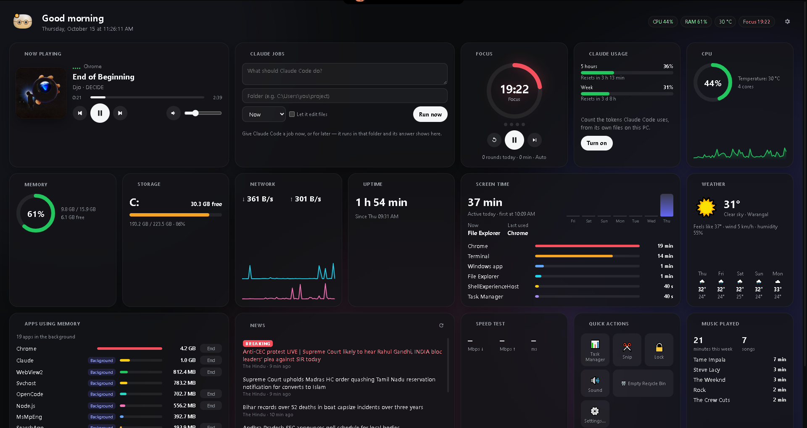
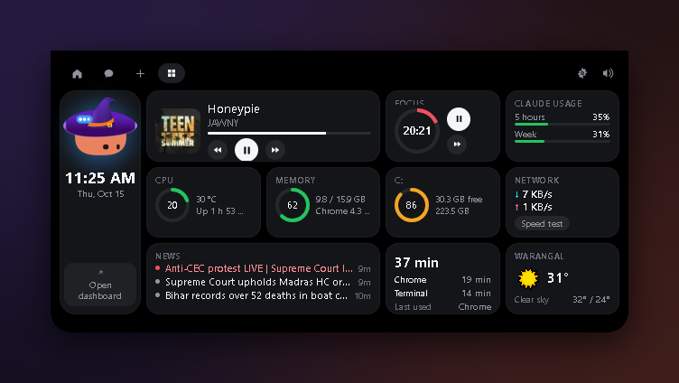
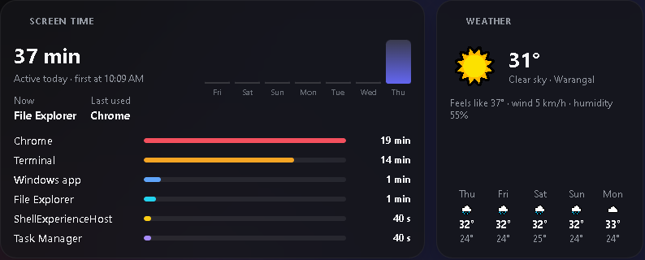
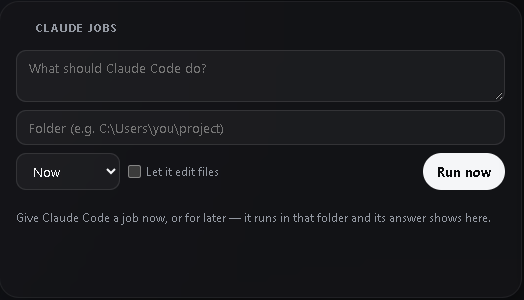
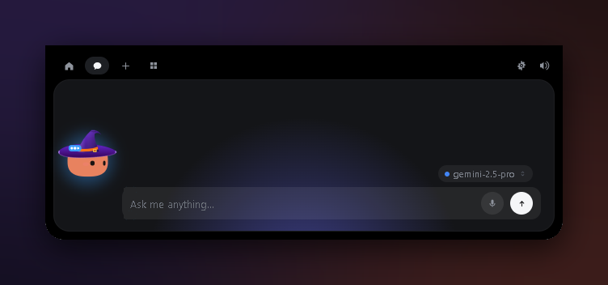
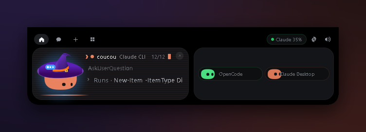

<div align="center">

# Coucou Command Center

**Your whole PC, your music, your focus and your Claude Code work — at the top of your screen.**

An unofficial Windows fork of [Coucou](https://github.com/Louis-CFM/coucou) by Louis Raillé, extended with a live dashboard, scheduled Claude Code jobs, a chat that can see your PC, voice input and more.




</div>

> [!NOTE]
> **Unofficial fork.** This is not made or endorsed by Louis Raillé. The name “Coucou”, the Mochi character, the icon and the sounds belong to him — see [`LICENSE-ASSETS.md`](LICENSE-ASSETS.md). The code is MIT ([`LICENSE`](LICENSE)). The original project's README is kept as [`README-upstream.md`](README-upstream.md).

---

## What it adds

### A dashboard inside the island

A new **⊞ tab** in the island, next to Home, Chat and +. Everything at a glance, without opening a window: the song playing (with controls), the focus timer, your Claude plan limits, CPU and temperature, memory and the app using the most, the system drive, network speed with a one-click speed test, breaking news, screen time and the weather. It only reads while it is open.



### The dashboard window

**Tray → Dashboard**, or **`Ctrl+Alt+B`**. Every tile at once on an animated backdrop that takes the colour of the album cover: apps using memory (with **End task**, never offered for Windows' own processes), screen time by app over the week, a 5-day forecast, top artists, a speed test and quick actions (Task Manager, Snip, Lock, Sound, Empty Recycle Bin). Drag tiles by their handle to rearrange them. Mochi sits in the corner and reacts: sweating when the CPU runs hot, wearing glasses while you focus, sleeping on breaks, dancing to music, jumping at breaking news.



### Claude jobs — Claude Code on a schedule

Give Claude Code a prompt and a folder, then run it **now**, **once**, **every day** or **on weekdays**. Coucou runs `claude -p` in that folder at that time and keeps the answer with the job. Permission requests still come to the island's **Allow / Deny** (tick “Let it edit files” to let it edit without asking). Mochi cheers when a job finishes.



### A chat that sees your PC — and a microphone

With each message, the chat (Gemini, Claude, OpenAI or a local model) gets a snapshot of what the dashboard reads right now: CPU, memory, the apps using it, music, the focus timer, screen time, headlines and your Claude jobs. Ask *“what's eating my RAM?”* or *“what am I listening to?”*. It can also act: play / pause / skip, set the volume, start or pause focus, open the dashboard, run a speed test, and **propose a Claude Code job, which waits for your click**.

Click **🎤**, speak, click again: Gemini writes it down with your own Google AI key and the chat sends it. The button grows with your voice.



### Claude CLI gets its own pill

Claude Code started from a plain terminal (Windows Terminal, PowerShell, cmd) now shows as **Claude CLI** instead of VS Code, with a live card: a ❯ prompt, a blinking cursor, drifting terminal lines, a scan line while it works and a green sweep when it's done. Sessions in VS Code or Cursor stay where they were. Allow / Deny work the same, and it can be your main pill.



### PC cleanup

A tile that shows what caches and old build folders take, then clears the ones you pick: temporary files older than a day, Chrome and Edge caches, npm and pip caches, the Recycle Bin, and the `target` / `node_modules` folders of your projects (unticked by default — they cost a rebuild). Nothing is deleted until you pick it and confirm twice, and Rust works out every path itself from a fixed list.

### Small tools

- **Keep awake**: 30 min, 1 h, 3 h or until you stop it, so the PC and its screen don't sleep. Nothing survives a restart.
- **Clipboard history** (off until you turn it on): the last 30 texts you copied, click to copy one again. Memory only, never written to disk; a password manager's copies are skipped.
- **Notes**: a scratchpad that saves itself to `%APPDATA%\Coucou
otes.json`.
- **Mic and camera in use**: a red chip in the dashboard header names the app using your microphone or camera right now, the same signal Windows' own taskbar dot reads.
- **Low-battery warning**: the island opens when a laptop is under 15 % and not charging.

### And also

- **Now Playing** for any Windows player — Spotify, YouTube in Edge or Chrome, VLC… — through Windows' own media controls, with cover art and volume.
- **An automatic Pomodoro**: starts when an agent starts working, moves to the next phase by itself, pauses while you're away.
- **Screen time** (off until you turn it on): the app in front every 5 s, never a window title.
- **Breaking news** from RSS feeds you pick; a fresh headline with one of your keywords opens the island.
- **Warnings** when memory, the system drive or the temperature run high.
- **Tap `Ctrl+Shift`** (nothing else in between) to open or close the island.

## Shortcuts

| Keys | Does |
|---|---|
| Tap `Ctrl+Shift` | Opens or closes the island (Settings → Shortcuts) |
| `Ctrl+Alt+B` | Opens the dashboard window |
| `Ctrl+Alt+Space` | Opens the chat |
| `Ctrl+Alt+A` | Jumps to the waiting permission or question |
| `Ctrl+Alt+T` | Brings the session's terminal forward |
| `Ctrl+Alt+→` / `←` | Next / previous pill |

All of Coucou's other shortcuts are listed in [`windows/README.md`](windows/README.md).

## Privacy

- **No telemetry.** Network calls only go to what you set up: your RSS feeds, Open-Meteo for the city you type, the speed test server (only when you click), and the AI provider you chat with.
- **Nothing is read while it is closed.** The PC is sampled only while a dashboard view is on screen; music and the focus timer arrive as events.
- **Local files only**, in `%APPDATA%\Coucou`: `screentime.json` (app names and seconds, 30 days), `listening.json` (songs heard 30 s or more), `jobs.json`, `focus.json`, `notes.json`. The clipboard history lives in memory only.
- **The chat snapshot** goes to the AI you chat with. Turn it off in **Settings → Dashboard → Let the chat see my PC**, and the actions with **Let the chat play music…**.
- **The microphone** records only between your two clicks; the audio goes to Google for the transcript and is never kept.

## Build it yourself

You need **Windows 10/11**, [Node.js](https://nodejs.org) 20+, [Rust](https://rustup.rs) (stable, MSVC) and the WebView2 runtime (already on Windows 11).

```powershell
git clone https://github.com/sricharanenabothula704-star/coucou.git
cd coucou\windows
npm install
npm run tauri dev      # run it
npm run tauri build    # installers in target\release\bundle\ (NSIS .exe and .msi)
```

Then turn on **Settings → Dashboard** options as you like, and set your city for the weather. For the microphone, add a Google AI key in **Settings → Chat**. For Claude jobs, [Claude Code](https://docs.anthropic.com/en/docs/claude-code) must be installed (`claude` on your PATH).

### Tests

```powershell
cd windows
npm test                          # TypeScript: news, dashboard, chat snapshot, pills, shortcuts…
cd src-tauri; cargo test --lib    # Rust: system stats, media, screen time, focus, jobs, voice, tap…
```

## Where things are

| Part | Code |
|---|---|
| PC vitals (PDH, Win32), Now Playing, screen time, focus, Claude jobs, voice | `windows/src-tauri/src/dashboard/` |
| Ctrl+Shift tap (Raw Input) | `windows/src-tauri/src/tap.rs` |
| PC snapshot in the chat's system prompt | `windows/src-tauri/src/chat.rs` |
| Dashboard window | `windows/src/dashboard/`, `windows/dashboard.html` |
| Island dashboard tab and pill cards | `windows/src/views/hub-dashboard.ts`, `windows/src/views/hub.ts` |
| Chat snapshot and actions | `windows/src/core/pc-context.ts`, `windows/src/island/pc-actions.ts` |
| News reader | `windows/src/news/news.ts` |
| Settings → Dashboard | `windows/src/settings/dashboard.ts` |

## Credits

Built on [Coucou](https://github.com/Louis-CFM/coucou) by **Louis Raillé** — the island, Mochi and everything this fork stands on are his work. Coucou for Android and the phone link are by **Rhytam Biswas**. Code under the [MIT License](LICENSE); name, character, icon and sounds under [`LICENSE-ASSETS.md`](LICENSE-ASSETS.md).
